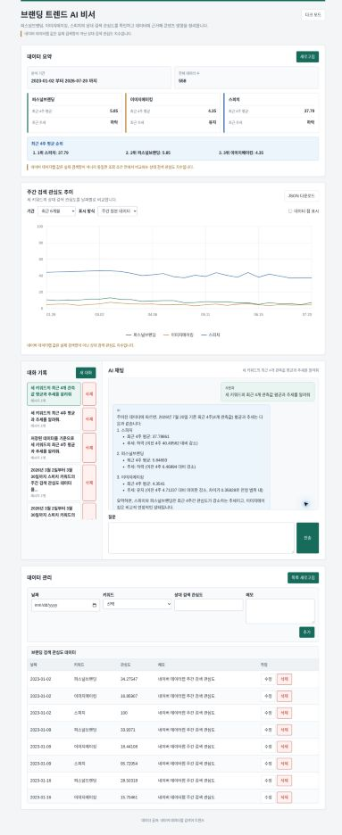
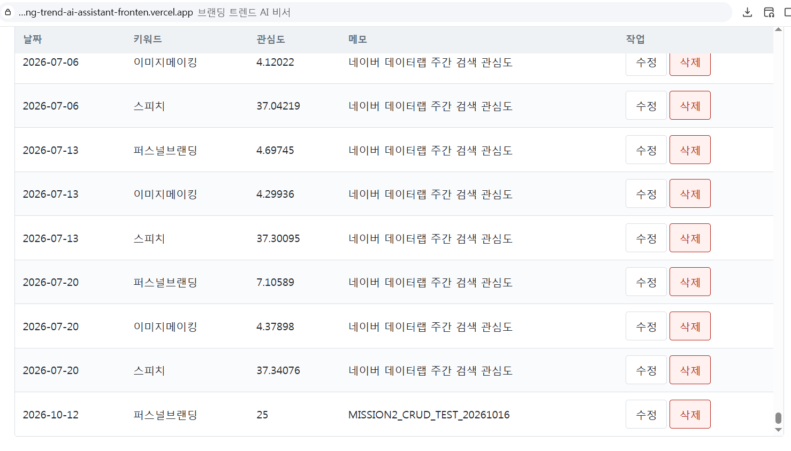
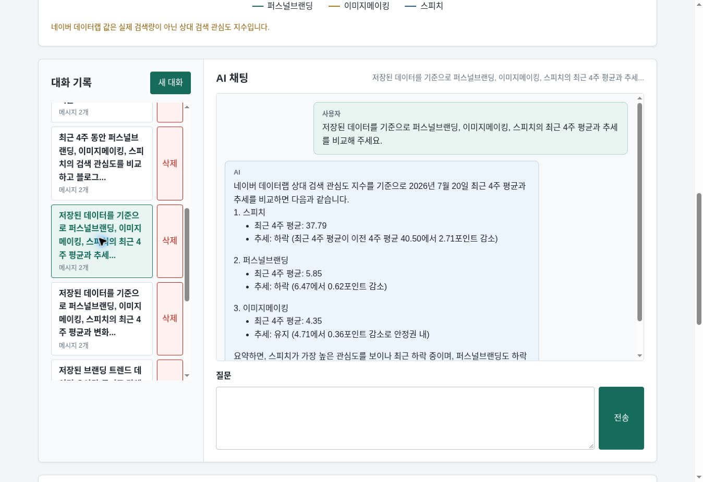
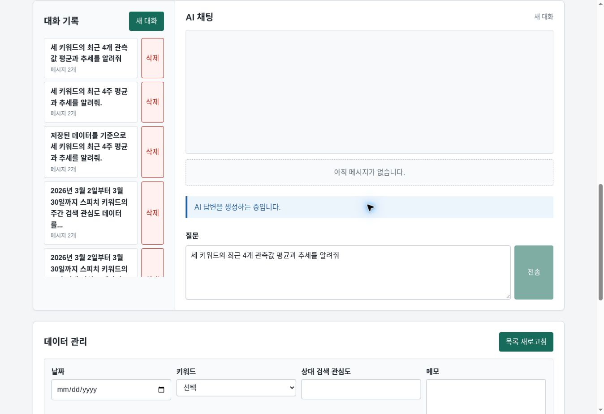

# 브랜딩 트렌드 AI 비서

네이버 데이터랩의 주간 상대 검색 관심도 데이터를 Firestore에 저장하고, 통계·그래프와 AI 채팅으로 확인하는 웹 애플리케이션입니다. AI는 데이터 요약을 문맥으로 활용하며, 필요하면 Function Calling으로 허용된 기간의 데이터를 조회합니다.

## 배포 및 현재 검증 상태

| 구성 요소 | 주소 | 확인 결과 |
| --- | --- | --- |
| 백엔드 (Render) | <https://branding-trend-ai-assistant.onrender.com> | 2026-10-21 커밋 `7bc1366` Live 확인 |
| Swagger | <https://branding-trend-ai-assistant.onrender.com/docs> | API 문서 |
| 프론트엔드 (Vercel) | <https://branding-trend-ai-assistant-fronten.vercel.app> | 2026-10-21 그래프 수정 커밋 `f35cd3f` 최종 배포 및 AI 응답 확인 |

운영 시계열 데이터 558건을 확인했습니다. AI 채팅·대화 저장·새로고침 후 불러오기, Function Calling, 외부 MCP 클라이언트(Claude Code)를 통한 Firestore 조회, 그래프·JSON 다운로드·다크 모드의 실환경 동작을 확인했습니다. 운영 UI에서 `2026-10-12` 퍼스널브랜딩 테스트 데이터 1건을 관심도 25로 생성·조회하고, 30으로 수정한 뒤 삭제했습니다. 원본 558건을 유지했고 삭제 후 총 558건을 확인했습니다.

## 공식 미션 요구사항 대응

상태는 제출자가 제공한 공식 요구사항과 구현 및 확인 결과를 대조한 것입니다.

| 요구사항 | 상태 | 근거·범위 |
| --- | --- | --- |
| FastAPI | 충족 | 백엔드 구현 및 테스트 |
| Firestore | 충족 | Firestore 연동, 운영 데이터 558건 확인 |
| GPT API | 충족 | 실환경 AI 채팅 응답 |
| 시계열 데이터 100개 이상 | 충족 | 운영 데이터 558건 확인 |
| 데이터 CRUD 및 요약 | 충족 | 운영 UI에서 테스트 레코드 1건 CRUD 수행, 원본 558건 유지 및 삭제 후 총 558건 확인 |
| AI 채팅 및 데이터 문맥 주입 | 충족 | 코드·테스트, 실환경 채팅 및 화면에 표시되는 답변 생성 중 안내 확인 |
| 대화 저장·조회·삭제·불러오기 | 충족 | API 테스트와 합성 테스트 대화의 실환경 저장·불러오기·삭제 확인 |
| HTML/CSS/JS 프론트엔드 | 충족 | Vercel 화면과 주요 기능 확인 |
| Render/Vercel 배포 | 충족 | Vercel `f35cd3f` 최종 배포, Render `7bc1366` Live 및 실제 AI 응답 확인 |
| Swagger | 충족 | Render `/docs` 접속 확인 |
| README 및 기능별 증빙 | 충족 | 보고서와 README에 존재 확인된 기능별 화면과 최신 배포·채팅 화면 연결 |
| 보너스 1: Function Calling, MCP 또는 GPT Actions 및 흐름 문서화 | 충족 | Function Calling 실환경 성공 및 흐름 설명. Claude Code 외부 MCP 클라이언트 연결·도구 호출과 Firestore 데이터 13건 반환 확인 |
| 보너스 2: 추가 통계, 그래프, CSV 또는 JSON, 다크 모드 | 충족 | 그래프·JSON 다운로드·다크 모드 실환경 확인 및 증빙 확보 |

## 주요 기능과 통계 기준

- 키워드별 통계 및 주간 상대 검색 관심도 그래프
- Firestore 데이터 조회·추가·수정·삭제 UI와 API
- AI 채팅 및 대화 기록 저장·조회·관리
- Function Calling을 통한 주간 데이터 조회
- 그래프 기간, 주간/4주 이동평균, 키워드 표시 제어
- JSON 다운로드 및 다크 모드

백엔드 요약은 키워드별 **최신 관측값 4개의 평균**을 계산합니다. 주간 데이터가 연속일 때 최근 4주 평균에 해당합니다. 프론트엔드의 4주 이동평균은 별도 계산이며, 연속된 주간 관측값 4개가 있는 구간에 표시됩니다. 상대 검색 관심도는 실제 검색량이 아니라 같은 조건에서 키워드 간 관심도 변화를 비교하는 지표입니다.

## Function Calling 및 MCP

실환경 Function Calling에서 도구 호출과 조회 결과를 확인했습니다.

```text
function_calling_response tool_call_count=1 tool_names=get_weekly_interest_data
trend_tool_success tool_name=get_weekly_interest_data returned_count=5
```

MCP 서버는 같은 읽기 전용 조회 기능을 제공합니다. 가짜 Firestore 기반 테스트와 공식 SDK의 stdio(표준 입력·출력) 연결 테스트에 더해, Claude Code 외부 MCP 클라이언트에서 서버 `Connected` 상태와 `query_weekly_interest` 도구를 확인했습니다. 실환경에서 `퍼스널브랜딩` 키워드의 2026-01-01~2026-03-31 기간을 읽기 전용으로 한 번 조회해 Firestore 레코드 13건을 반환받았습니다. 오류는 없었습니다.

원본 증빙: [MCP 연결 로그](evidence/mcp_connection_oct19.txt), [Claude Code stream-json 원본](evidence/mcp_query_weekly_interest_oct19.jsonl), [UTF-8 JSON 변환본](evidence/mcp_query_weekly_interest_oct19_utf8.json). 원본과 변환본의 15개 JSON 이벤트는 내용과 순서가 일치합니다. `query_weekly_interest` 호출 1회와 같은 호출 식별자의 결과 1회가 대응되고 `observation_count=13`, 최종 `subtype=success`, `is_error=false`를 확인했습니다. 도구 검색용 ToolSearch는 자료 조회 횟수에서 제외합니다.


## 자동화 테스트 및 브라우저 검증

| 대상 | 테스트 수 | 결과 |
| --- | ---: | --- |
| 백엔드 | 85 | 모두 통과 |
| 프론트엔드 | 23 | 모두 통과 |
| 합계 | 108 | 모두 통과 |

백엔드는 `python -m unittest discover -s backend/tests -v`, 프론트엔드는 `node --test frontend/tests/*.test.mjs`로 실행했습니다. 프론트엔드 테스트에는 가짜 응답으로 대화 목록·선택·상세 조회·메시지 복원을 검사하는 테스트 7개가 포함됩니다. 자동화 테스트는 주로 가짜 Firestore와 모의 응답을 사용하므로 실환경 브라우저 검증과 구분합니다. 실환경 CRUD는 기존 558건과 별도로 테스트 레코드 1건만 대상으로 확인했습니다.

## 제출용 증빙

### 필수 화면 1 데이터 요약과 AI 채팅



주석: 데이터 558건과 키워드별 요약, 수정된 선 그래프, 질문과 답변을 한 화면에 담았습니다. 최근 4개 관측값 평균은 퍼스널브랜딩 5.85, 이미지메이킹 4.35, 스피치 37.79입니다. 원본을 클릭하면 확대해서 확인할 수 있습니다.

### 필수 화면 2 데이터 관리



주석: 원본 자료와 별도로 테스트 자료 1건을 추가해 559건이 된 상태입니다. 이후 관심도 25를 30으로 수정하고 삭제해 원본 558건으로 복원했습니다.

### 필수 화면 3 대화 불러오기



주석: 저장된 대화를 선택한 후 해당 대화의 질문과 답변이 채팅 영역에 다시 표시된 화면입니다.

### 채팅 로딩 표시



주석: 질문 전송 직후 ‘AI 답변을 생성하는 중입니다.’가 실제 화면에 표시되고 전송 버튼이 비활성화됩니다. 마우스 포인터는 버튼 밖에 있습니다. 답변 생성 중 안내와 Render 첫 요청 지연 안내는 서로 다른 상태입니다.

### 추가 기능별 증빙

- [실제 데이터가 표시된 대시보드](evidence/readonly_01_dashboard.png)
- [다크 모드 대시보드](evidence/readonly_05_dark_mode.png)
- [Render Swagger](evidence/readonly_06_render_swagger.png)
- [저장된 AI 채팅](evidence/submission_chat_saved.png)
- [수정된 선 그래프와 요약·채팅 통합 화면](evidence/submission_summary_chat_full_oct21.jpg)
- [JSON 다운로드](evidence/submission_json_download.png)
- [테스트 레코드 조회](evidence/submission_crud_read.png)
- [테스트 레코드 생성](evidence/submission_crud_create.png)
- [테스트 레코드 수정](evidence/submission_crud_update.png)
- [테스트 레코드 삭제](evidence/submission_crud_delete.png)

- [요약과 질문·답변을 함께 표시한 운영 화면](evidence/submission_summary_chat_oct19.jpg)
- [대화 선택 후 메시지를 불러온 운영 화면](evidence/submission_conversation_restored_oct19.jpg)

## 로컬 실행

프로젝트 루트에서 백엔드 의존성을 설치하고 실행합니다.

```powershell
python -m venv .venv
.venv\Scripts\Activate.ps1
Copy-Item .env.example .env
# .env에 Firebase와 OpenAI 설정 입력
python -m pip install -r backend/requirements.txt
python -m uvicorn backend.app.main:app --reload --host 127.0.0.1 --port 8000
```

별도 터미널에서 프론트엔드를 실행합니다.

```powershell
python -m http.server 5500 --directory frontend
```

브라우저에서 `http://localhost:5500`을 엽니다. 로컬 프론트엔드는 `http://127.0.0.1:8000` 백엔드에 연결합니다. Firebase 및 AI 자격증명은 비밀 환경 변수로 관리하고 저장소나 로그에 기록하지 마세요.

## 기술 스택과 역할 분리

Python 3.10 이상, FastAPI, Uvicorn, Pydantic, Firebase Admin SDK, OpenAI SDK, python-dotenv, MCP SDK를 사용합니다. 프론트엔드는 HTML/CSS/JavaScript이며 프레임워크를 사용하지 않습니다.
라우터는 주소별 요청·응답을, 서비스는 요약 계산·Firestore 접근·AI 호출을 처리합니다. Pydantic은 날짜·키워드·관심도를 검증하며, 관심도에 문자·음수·100 초과 값을 넣으면 422로 거절합니다.

### Firestore 컬렉션 구조

| 컬렉션 | 주요 필드 | 역할 |
| --- | --- | --- |
| `data` | `date`, `keyword`, `value`, `memo`, `created_at`, `updated_at` | 주간 상대 검색 관심도 저장 |
| `conversations` | `title`, `messages`, `created_at`, `updated_at` | 대화 제목과 사용자·AI 메시지 저장 |

과제의 기본 데이터 형식인 date·value·memo에 `keyword`를 추가해 세 키워드의 관측값을 구분합니다. 컬렉션의 문서 ID로 수정·삭제할 대상을 식별합니다.

## 환경변수

| 변수 | 위치 | 용도 |
| --- | --- | --- |
| FIREBASE_PROJECT_ID | Render / 로컬 .env | Firebase 프로젝트 |
| FIREBASE_SERVICE_ACCOUNT_JSON 또는 FIREBASE_SERVICE_ACCOUNT_PATH | Render / 로컬 .env | 인증정보. 둘 중 하나 |
| AI_PROVIDER | Render / 로컬 .env | openai |
| OPENAI_API_KEY | Render / 로컬 .env | 비밀키 |
| OPENAI_BASE_URL | Render / 로컬 .env | 사용 중인 GPT API 주소 |
| OPENAI_MODEL | Render / 로컬 .env | 해당 API에서 허용한 GPT 모델 |
| CORS_ORIGINS | Render / 로컬 .env | 허용 프론트 주소, 쉼표로 구분 |
| AI_MAX_OUTPUT_TOKENS | Render / 로컬 .env | 호출당 출력 제한, 기본 800, 범위 1~4096 |
| AI_TOKEN_PARAMETER | Render / 로컬 .env | 기본 max_completion_tokens, 호환 API는 max_tokens |
| API_BASE_URL | Vercel | 공개 백엔드 주소 |

CORS는 다른 주소의 프론트엔드가 백엔드 응답을 읽도록 허용하는 설정입니다. 운영 CORS_ORIGINS에는 실제 Vercel 주소를 넣습니다. 값이 없을 때 적용되는 기본 허용 목록에는 `http://localhost:5500`과 `http://127.0.0.1:5500`이 모두 포함되어 있습니다. API 인증을 대신하지 않습니다. OpenAI·Firebase 비밀키는 백엔드에만 둡니다.

## 기존 배포에 보완 사항 반영

기존 Vercel 프로젝트 Root Directory는 `frontend`입니다. 환경변수 `API_BASE_URL`을 `https://branding-trend-ai-assistant.onrender.com`으로 설정한 뒤 재배포합니다. `vercel.json`의 빌드 명령이 환경변수를 읽어 `js/runtime-config.js`를 생성합니다. 주소가 없으면 빌드가 실패합니다. 로컬 실행은 기본 127.0.0.1:8000에 연결하며 Node 빌드가 필요 없습니다.
기존 Render 서비스에 저장소 변경을 배포하며 기존 비밀키는 유지합니다. 첫 데이터 로딩 중 서버 준비로 지연될 수 있다는 안내를 표시합니다.

AI SDK 자동 재시도는 0회, 도구 실행은 최대 3회입니다. 최종 답변까지 GPT 호출은 최대 4회이며 각 호출 출력은 기본 800토큰으로 제한합니다. 입력 토큰과 전체 누적 과금의 상한은 아니므로 개발 시 질문 횟수도 작게 유지합니다.

## 컨텍스트 주입과 도구 호출 근거

1. 채팅 라우터가 summary API와 같은 요약 서비스를 호출합니다.
2. 기간·개수·통계·추세 JSON을 시스템 프롬프트에 넣습니다.
3. 시스템 프롬프트와 질문으로 GPT API를 호출합니다.
4. 질문과 답변을 conversations에 자동 저장합니다.

### 컨텍스트 주입의 장점과 단점

| 구분 | 내용 | 이 프로젝트에서의 적용·대응 |
| --- | --- | --- |
| 장점: 데이터에 근거한 답변 | 일반적인 지식만 사용하는 답변보다 저장된 데이터의 기간·개수·통계·추세를 반영해 사용자 상황에 맞는 답변을 만들 수 있습니다. | Firestore의 558건 전체를 그대로 보내지 않고 summary 서비스가 계산한 요약을 시스템 프롬프트에 넣습니다. |
| 장점: 답변의 일관성과 설명 가능성 | 같은 요약 정보를 기준으로 답하므로 답변의 기준이 분명해지고, 화면의 수치와 AI 답변을 비교해 근거를 확인할 수 있습니다. | 최근 4개 관측값 평균과 추세를 요약 화면과 AI 답변에서 교차 확인했습니다. 특정 기간의 원자료가 필요할 때만 허용된 조회 도구를 호출합니다. |
| 단점: 프롬프트 길이·비용 증가 | 원자료를 많이 넣을수록 입력 토큰, 응답 시간과 API 비용이 증가하고 모델의 입력 한도를 넘을 수 있습니다. | 전체 원자료 대신 기간·개수·핵심 통계·추세만 주입하고, 출력은 `AI_MAX_OUTPUT_TOKENS` 기본 800토큰으로 제한합니다. |
| 단점: 보안·개인정보 노출 위험 | 시스템 프롬프트에 비밀키나 민감정보를 넣으면 외부 AI API로 전달되거나 답변에 노출될 수 있습니다. | OpenAI·Firebase 비밀값은 백엔드 환경변수로만 관리하며, 프롬프트에는 공개 가능한 통계 요약만 넣습니다. |
| 단점: 오용·잘못된 해석 위험 | 사용자의 지시가 데이터의 의미를 왜곡하거나, 오래된·불완전한 요약을 모델이 확정적 사실처럼 표현할 수 있습니다. | 상대 관심도를 실제 검색량과 구분하고 자료 기준일을 명시합니다. 도구 이름과 인자를 서버에서 검증하며 MCP 조회는 읽기 전용으로 제한합니다. AI 답변은 참고용 분석이므로 화면의 원자료와 함께 확인합니다. |

따라서 컨텍스트 주입은 AI가 내 데이터를 근거로 답하게 만드는 장점이 있지만, 많은 데이터를 무조건 넣는 방식은 적절하지 않습니다. 이 프로젝트는 필요한 요약만 전달하고, 비밀정보를 제외하며, 도구 호출 범위와 출력 길이를 제한하는 방식으로 단점을 줄였습니다.

전체 요약 질문은 시스템 프롬프트를 활용합니다. 특정 기간의 주별 원자료가 필요한 질문은 모델이 `get_weekly_interest_data`를 선택할 수 있습니다. 서버가 도구 이름과 인자를 검증한 후 Firestore를 읽고 결과를 GPT에 전달합니다.
MCP는 외부 클라이언트 → `query_weekly_interest` → 공통 조회 서비스 → Firestore → 클라이언트 흐름입니다. 외부 MCP 원본의 13건 반환과 모의 자동화 테스트는 구분합니다.

추가 통계는 최근 4개 평균, 직전 4개 평균, 두 평균의 차이, 최근 평균 순위입니다. 차이의 절댓값이 0.5 이하면 유지, 초과하면 부호에 따라 상승·하락입니다. 그래프·JSON 다운로드·다크 모드는 위 증빙에서 확인할 수 있습니다.

## 보완 및 검증 이력

2026-10-19 로컬 자동화 테스트는 백엔드 85개와 프론트엔드 23개, 총 108개입니다. 해당 테스트는 외부 GPT 과금과 운영 데이터 변경 없이 실행했습니다. 코드 보완 커밋은 `7bc1366`입니다. 이후 `f35cd3f`에서 그래프 선에 `fill: none`이 우선 적용되도록 CSS 선택자를 수정했고 프론트엔드 테스트 23개가 통과했습니다. 2026-10-21 Vercel `f35cd3f` 최종 배포와 Render `7bc1366` Live, 실제 AI 응답을 확인했습니다. 같은 날 로딩 안내의 실제 표시와 요약·질문·답변 통합 화면을 추가 확인했습니다.

이번 실행 원문: [백엔드 테스트 로그](evidence/backend_tests_oct19.txt), [프론트엔드 테스트 로그](evidence/frontend_tests_oct19.txt).

## 2026년 10월 21일 배포 증빙

- [Vercel 최종 배포](evidence/submission_vercel_ready_oct21.png)
  주석: 그래프 수정 커밋 `f35cd3f`의 최종 배포 화면입니다. 빨간 Error 행은 `7bc1366` 첫 빌드에서 API_BASE_URL이 누락되어 실패한 기록이며, Production 환경변수에 Render API 주소를 설정한 후 배포에 성공했습니다.
- [Render 커밋 7bc1366 Live](evidence/submission_render_live_oct21.png)
  주석: 상단 커밋과 Events의 Deploy live for 7bc1366에서 백엔드 보완 코드의 배포를 확인했습니다. `f35cd3f`는 프론트엔드 CSS만 변경한 커밋입니다.
- [재배포 후 질문과 AI 답변](evidence/submission_chat_after_deploy_oct21.png)
  주석: 새로고침 후 질문을 전송해 스피치 37.79·하락, 퍼스널브랜딩 5.85·하락, 이미지메이킹 4.35·유지 답변을 확인했습니다. 자료 기준일은 2026-07-20입니다.
